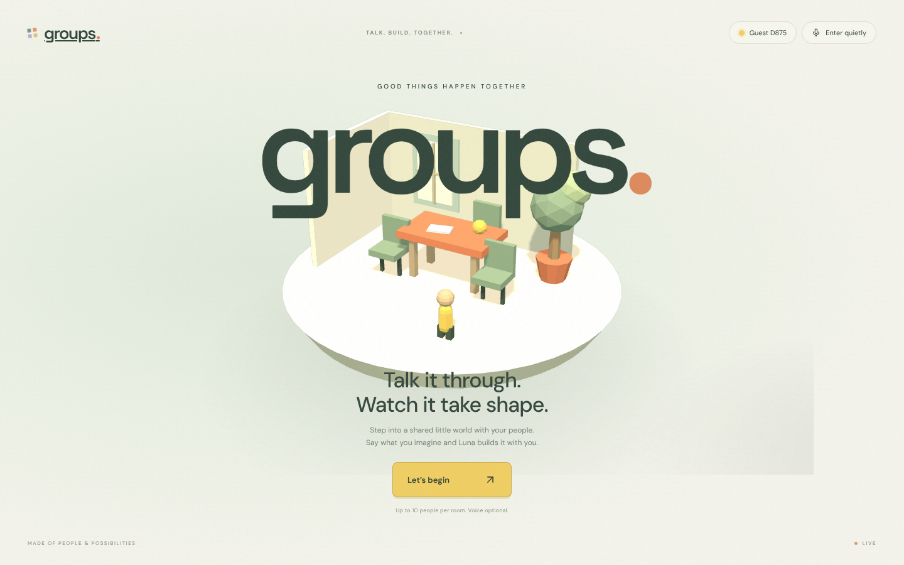
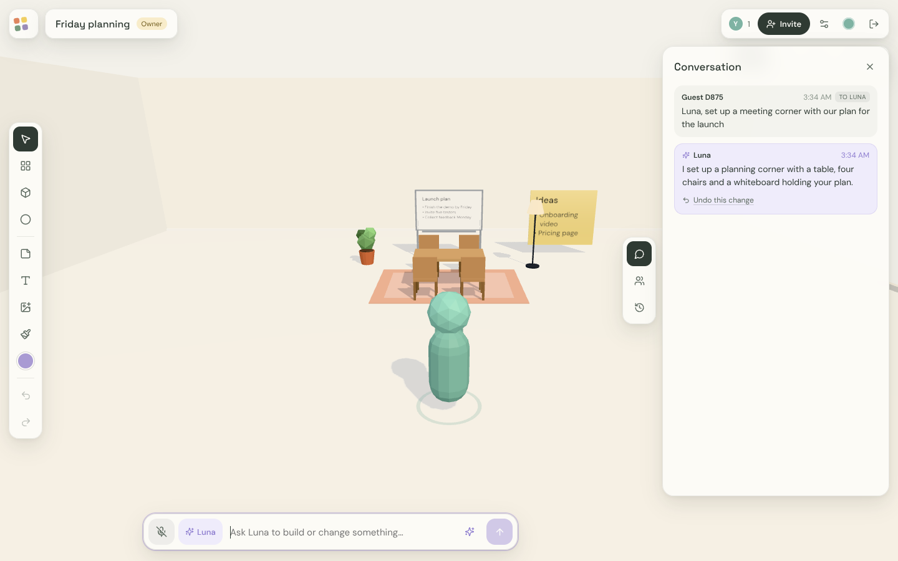
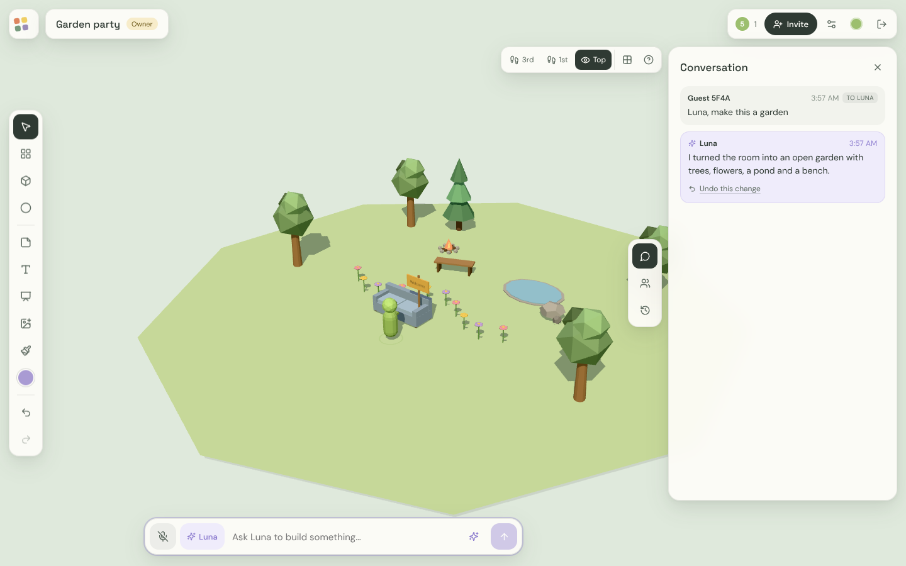
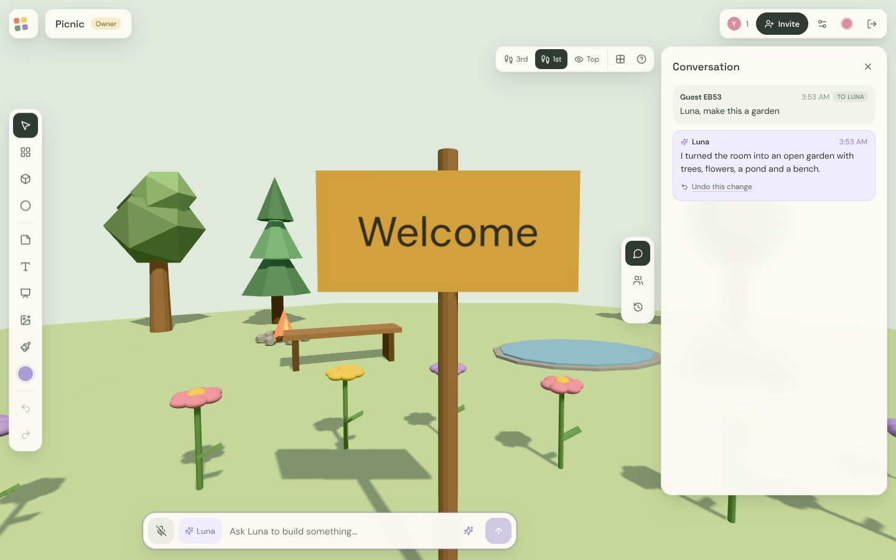
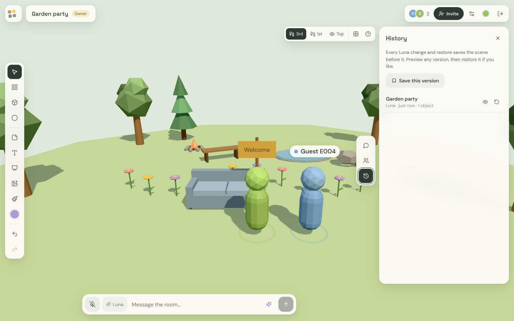
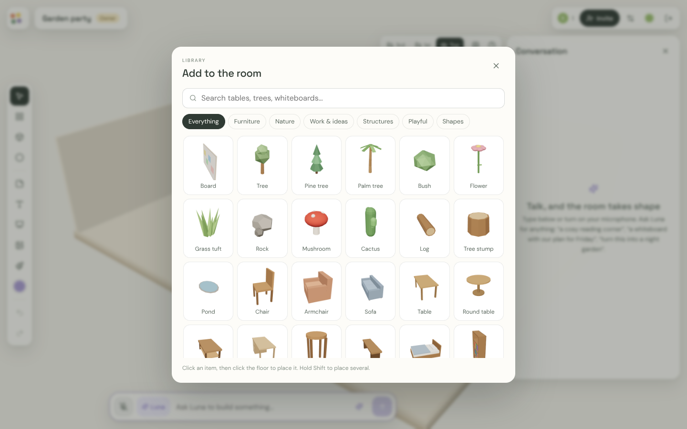
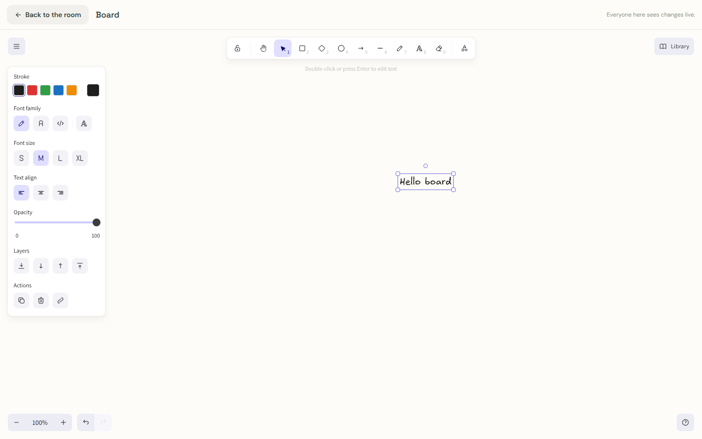
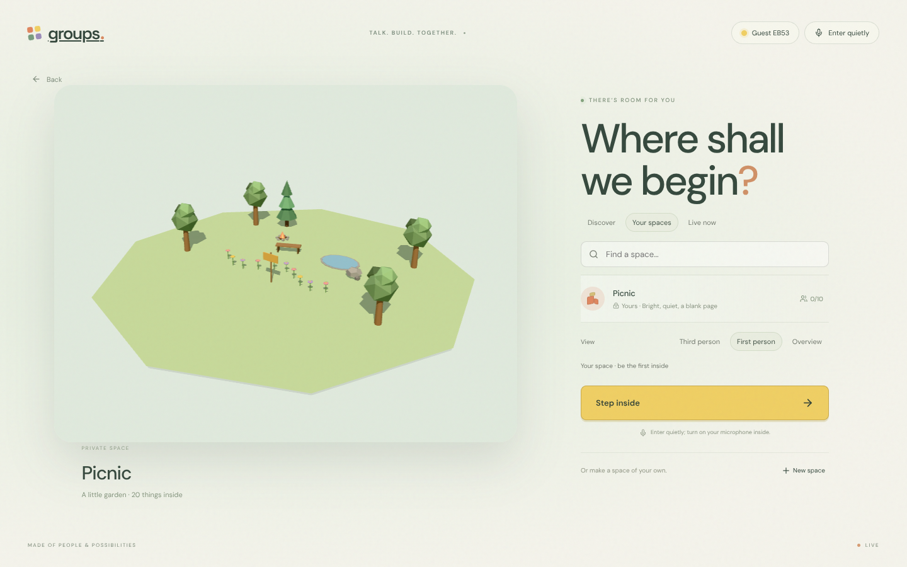
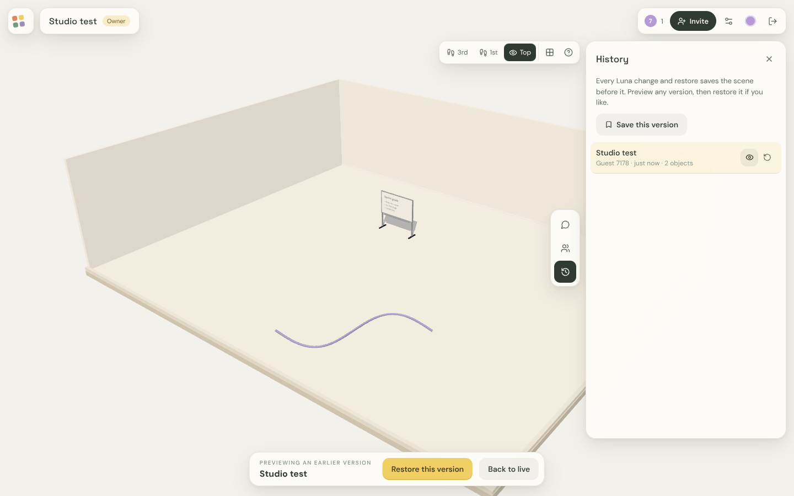
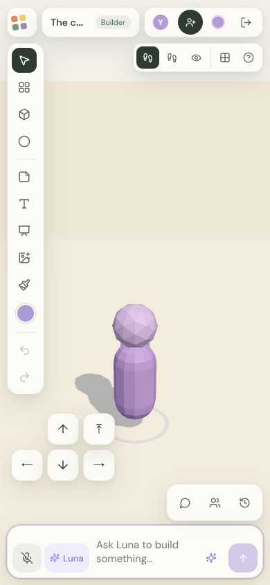

# Groups

**A small shared 3D world where you talk with your people and an AI builds what you describe.**


<!-- Replace with your own hero image or GIF: docs/images/hero.gif -->

Groups is a small shared 3D world for a few people at a time. You walk around together as avatars, talk by voice or text, and **Luna**, the built-in assistant, turns what you say into things in the room. It can build furniture and gardens, write plans onto whiteboards and set up sticky-note boards for brainstorming. Everything stays editable by hand, every Luna change can be undone, and the room's history can be previewed and restored.

## What it does

### Ask, and the room takes shape
Type or say "Luna, set up a planning corner" and Luna builds it from a catalog of 70+ low-poly models, writes your plan on a whiteboard, and replies in the chat with an *Undo this change* link.

| A planning corner | An open-air garden |
| --- | --- |
|  |  |

### Explore together
Walk in third or first person with real physics, see each other as avatars with name tags, and talk with spatial voice.

| First person | Two people in one room |
| --- | --- |
|  |  |

### Build by hand
A library of models, shapes, notes, images, floor paint and collaborative Excalidraw boards that everyone edits live.

| Library | Shared board |
| --- | --- |
|  |  |

### Find and join spaces
The lobby shows live miniatures of each space's real contents. Every change is saved as a version you can preview and restore.

| Lobby with live preview | Version history |
| --- | --- |
|  |  |

### Works on phones too


### More images
<!--
Add your own screenshots or GIFs here, for example:


-->
_Screenshots of your own builds go here._

## Run it

Node.js 22.13 or newer.

```sh
npm install
npm run dev          # http://localhost:5173 (frontend) + backend on :3001
```

Production-style:

```sh
npm run build
npm start            # http://localhost:3001
```

Microphone access needs HTTPS except on localhost.

Deploying: see [DEPLOY.md](DEPLOY.md). It covers a free setup with no card: Vercel for the frontend, Render for the realtime backend and Neon Postgres for data. The Docker image also runs on its own.

## Using it

1. **Lobby:** a short animated opening, then a directory of spaces: *Discover* (public), *Your spaces* (owned or joined) and *Live now*. Selecting a space shows a live miniature of its actual contents. Set your name, choose a view (third person, first person or overview) and whether your microphone opens on entry.
2. **Create a space:** pick a name, a starting theme (calm room, garden, studio, seaside, night sky) and who can find it. New spaces are private.
3. **In the room:**
   - **Walk:** WASD or the arrow keys, Space to jump, drag to look, scroll to zoom. Touch devices get an on-screen pad.
   - **Talk:** the composer at the bottom sends messages. With **Luna** toggled on, messages go to Luna and it acts right away. Otherwise, while auto-build is on, Luna listens and acts when the conversation pauses. Small talk doesn't trigger changes. Say "Luna, …" by voice to address it directly.
   - **Build by hand:** open the **Library** (70+ low-poly models and shapes), or add notes, text panels, boards, images or floor paint. Click to select, drag to move (G toggles grid snapping), Q/E to turn and Delete to remove. The inspector covers colour, size, proportions, height, physics behaviour and writing.
   - **Boards:** double-click a board to open a full Excalidraw canvas that everyone edits live. The 3D board shows its contents.
   - **History:** each Luna change and restore saves the scene before it. Use *Undo this change* in the chat, or preview and restore any version from the History panel. Ctrl+Z undoes your own recent edits.
   - **People and access:** Invite creates seven-day links that let people build or only visit. Space settings cover name, description, visibility, the default visitor role, members (change roles, remove) and deleting the space.

## Connect a model for Luna

Copy `.env.example` to `.env.local` and restart. The default is direct OpenAI:

```dotenv
GROUPS_AI_PROVIDER=openai
GROUPS_AI_MODEL=gpt-6-luna
OPENAI_API_KEY=...
```

`gateway` (Vercel AI Gateway) and `compatible` (any OpenAI-compatible endpoint with tool calling, local or hosted) are also supported. Without a configured model, Luna shows as offline and everything else keeps working. `GET /api/config` reports what is configured; credentials are never exposed.

Luna receives the room (objects with sizes, environment, recent conversation including its own replies, board text and up to four attached images), a spatial guide and the model catalog. It acts through one validated tool, `apply_room_operations`: add, update or remove objects and set the environment. A run is bounded to four steps, 16k output tokens and 120 seconds, with one run per room at a time. Luna cannot run code, fetch URLs or touch permissions.

## Voice

Audio goes directly between browsers over WebRTC, and nearby people sound louder. Speech becomes conversation through the browser's speech recognition (Chrome, Edge, Safari). For other browsers, set `GROUPS_TRANSCRIPTION=openai` to transcribe short voice clips on the server; it is billed per audio minute. For restrictive networks, add a TURN server via `GROUPS_ICE_SERVERS`. Ambient soundscapes are optional and off by default.

## External assistants (MCP)

Set `GROUPS_MCP_TOKEN` (32+ characters), then point an MCP client at `http://localhost:3001/mcp?space=<space-id>&room=<room-id>` with `Authorization: Bearer <token>`. The tools are `get_room_context` and `apply_room_operations`, which share Luna's commit path. The token is administrative, so keep it on trusted machines.

## Data

Locally, everything lives in `.groups-data/groups.sqlite` (plus `auth-secret`). Back up the whole directory while the server is stopped. `GROUPS_DATA_DIR` moves it. Set `DATABASE_URL` to use Postgres instead; hosted deployments need this because their disks are temporary. `scripts/copy-to-postgres.mjs` copies local data across. Older data is migrated automatically. Rooms that earlier versions forked for every change are folded into checkpoints of the live room, and each room keeps its 150 most recent checkpoints.

## Checks

```sh
npm test               # 30 server, physics, sync and integration tests (no paid model calls)
npm run build && npm run test:browser   # Chrome smoke test with a mock model; set CHROME_PATH if needed
```

## Limits worth knowing

- Guest identities are tied to the browser; there's no account recovery or cross-device sign-in yet.
- Up to 10 people per room on one Node process with local SQLite. Voice is a peer-to-peer mesh.
- Images are stored inline, up to about 2 MB each. Boards hold up to 4,000 elements.
- Live behaviour of the configured paid model, real microphones and cross-network voice need a real session to confirm; the automated checks use a mock model.

See [ARCHITECTURE.md](ARCHITECTURE.md) for how it fits together, [ROADMAP.md](ROADMAP.md) for what's next and [CONTRIBUTING.md](CONTRIBUTING.md) to get involved.

## Contributing

Contributions are welcome. See [CONTRIBUTING.md](CONTRIBUTING.md) for setup, conventions and good first issues, and [ROADMAP.md](ROADMAP.md) for bigger directions.

## License

[MIT](LICENSE)
